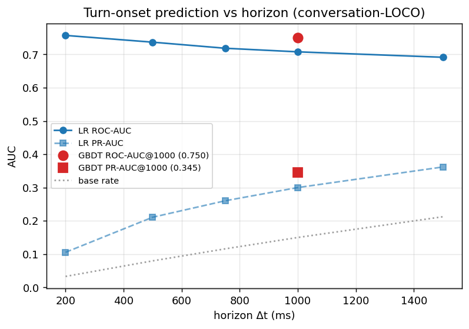

# Turn-Onset Prediction from Causal Audio Features

An empirical study of whether the *timing* of conversational turn transitions can be predicted from acoustic and temporal signals that are available strictly **before** the transition.

**Research question:** given dual-channel conversational audio up to time *t*, can a model predict whether the *other* speaker will start speaking within the next Δt ms — using only causal features (nothing from after *t*)? We answer this on the public **Open Yap 1K sample** (TheAgenticDataCompany, CC-BY-4.0): 16 two-channel conversations, 8.92 h, 8 speakers, evaluated with leave-one-conversation-out (LOCO) and leave-one-speaker-pair-out protocols.



**Main result.** Turn onsets **1 s ahead are predictable at ROC-AUC ≈ 0.76 / PR-AUC ≈ 0.35 (base rate 0.15)** from a 73-feature causal acoustic + timing stack. Predictability is *higher* for short horizons (LR ROC-AUC 0.76 at 200 ms → 0.69 at 1500 ms): onset timing behaves like a short-horizon rhythmic phenomenon, not a long-range countdown.

| horizon Δt | base rate | LR pooled ROC / PR | RF per-fold ROC (mean ± sd) | GBDT pooled ROC / PR |
|---|---|---|---|---|
| 200 ms | 0.033 | 0.757 / 0.106 | — | — |
| 500 ms | 0.080 | 0.737 / 0.211 | — | — |
| 750 ms | 0.116 | 0.718 / 0.260 | — | — |
| **1000 ms** | **0.150** | **0.708 / 0.300** | **0.762 ± 0.067 / 0.348** | **0.750 / 0.345** |
| 1500 ms | 0.212 | 0.691 / 0.362 | — | — |

(Pooled = metrics over concatenated held-out predictions. RF pooled AUC is not materialized; RF is reported as per-fold mean ± sd. Source: `results/summary.json`, `results/models_loco_1000.json`.)

---

## Question

Does natural conversational audio contain measurable, **causal** signals that let a system predict *when* the other party will take the floor? We frame this as a binary per-decision-point question: at every 200 ms decision point *t*, label = 1 iff the other speaker's next turn-onset lies in `(t, t + Δt]`.

## Why this question?

Turn-taking is fast (~200 ms switch gaps), entrained, and mostly invisible to transcripts. A system that can *forecast* imminent onsets enables natural-sounding duplex agents, latency-aware ASR barge-in handling, and assistive monitoring. The open question is how much of the signal lives in the acoustic channel alone — computable in real time — versus higher-level discourse structure. This project bounds the acoustic-only answer with a lightweight, audited feature stack (no neural models).

## Experimental setup

End-to-end pipeline (scripts in `scripts/`, parameters in `configs/turn_prediction.yaml`):

1. **Turn segmentation** (`scripts/01`, `02`): per-channel energy-VAD on 10 ms frames (noise floor + 20 dB, 60 ms hangover); within-speaker gaps ≤ 400 ms merged → 20,935 turns.
2. **Transition taxonomy** (`scripts/02`): each new turn classified vs. the other speaker's latest turn by start time → 13,643 transitions: clean 10,976 (80.4%), backchannel 1,525 (11.2%), interruption 811 (5.9%), overlap-no-floor 313 (2.3%), first-segment 18.
3. **Decision points** (`scripts/04`): 200 ms grid → 160,295 labeled points (labels from audio VAD segments, **not** ASR words).
4. **Features** (`src/research/window_features.py`, `audio.py`): causal windows `[t − 1.5 s, t)`.
5. **Models** (`scripts/05`): majority / LogisticRegression / RandomForest (80 trees) / HistGradientBoosting (160 iters), median imputation, standardized features for LR, train rows capped at 90k/fold.
6. **Evaluation**: conversation-LOCO (16 folds; train/test conversations always disjoint) and speaker-pair-LOCO (4 folds; entire unseen pair held out). Pooled + per-fold mean ± sd ROC-AUC / PR-AUC.

## What the model sees

At decision time *t*, per channel (a/b), window statistics over `[t − 1.5 s, t)` for: RMS dB, zero-crossing rate, spectral centroid / bandwidth / rolloff / flux, autocorrelation F0 (60–400 Hz), energy slope; plus voiced fraction, and timing — `pause_since_last_speech`, `elapsed_s`, `current_seg_dur_s`. **73 causal features** (see `FEAT_COLS`).

It **never** sees:

- any audio after *t* (windows close strictly before *t*; in-flight frame excluded via shifted min/max),
- future segments, onsets, or transition timestamps,
- ASR transcripts or words at any time (audio-derived labels only),
- any `label_*` column or any column derived from them,
- a role-resolved acoustic view: `a_*`/`b_*` are **per-channel**, not "current speaker vs. other" (the current speaker is whichever channel was most recently active at *t*).

## Results

### Conversation-LOCO @ 1000 ms (per-fold mean ± sd; `models_loco_1000.json`)

| model | ROC-AUC | PR-AUC | PR-AUC (weighted) |
|---|---|---|---|
| majority | 0.500 ± 0.000 | 0.131 | 0.150 |
| LR | 0.715 ± 0.072 | 0.281 | 0.291 |
| RF | **0.762 ± 0.067** | **0.348** | 0.353 |
| GBDT | 0.752 ± 0.065 | 0.332 | 0.339 |

Trees beat linear by ~4–5 ROC points — pause × energy-modulation interactions matter. Pooled (figure-consistent) values: LR 0.708/0.300, GBDT 0.750/0.345 (`summary.json`); pooled vs. per-fold-mean differ because folds are unequal in size.

### Ablation (LR @ 1000 ms; `analysis_1000.json`)

| feature set | ROC-AUC | n features |
|---|---|---|
| temporal only | **0.668** | 3 |
| channel-A acoustics | 0.607 | 12 |
| channel-B acoustics | 0.600 | 12 |
| F0 only | 0.637 | 8 |
| all except F0 | 0.714 | 89 |
| full | 0.714 | 101 |

### Generalization: speaker-pair-LOCO @ 1000 ms (`models_pairs_1000.json`)

| model | ROC-AUC | PR-AUC | vs. conv-LOCO ref (GBDT per-fold 0.752) |
|---|---|---|---|
| LR | 0.621 ± 0.027 | 0.259 | — |
| GBDT | **0.667 ± 0.014** | **0.278** | **≈ −0.086** |

Holding out an entire unseen speaker pair costs ≈ 8–9 ROC points: a meaningful share of the signal is dyadic, entrained rhythm rather than universal acoustics — but fully novel pairs stay well above chance.

### What seems to matter?

Top RandomForest importances (interpretability only): `current_seg_dur_s` (0.038), `pause_since_last_speech` (0.037), then spectral-flux max / energy-slope mean on one channel (0.017 each) — **rhythm/timing first, spectral/energy modulation second**. F0 contributes nothing beyond the rest (`full` ≈ `no_f0`); a 8-feature F0-only stack reaches only 0.637. Useable operating points (GBDT pooled @1000): θ=0.20 → predict 25.5%, recall 0.548, precision 0.323; θ=0.50 → predict 2.5%, recall 0.084, precision 0.502 (3.3× lift over the 0.150 base); best-F1 θ=0.215 (prec 0.336 / rec 0.516 / F1 0.407).

## Leakage and failed experiments

Leakage discipline is **central** to this study. Two real leaks were caught during development, fixed, and are documented in `LEAKAGE_AUDIT.md` (Field Notes):

1. **Non-causal energy slope**: the first implementation measured ~75 ms of *future* audio in the current frame's slope; fixed to a trailing causal fit and the entire feature cache was rebuilt before any dataset was created.
2. **Label-column sweep**: the ablation script's "full" / "no-F0" lists silently swept numeric `label_*` columns → instantaneous ROC-AUC 1.0000; invalid, discarded, and the modeling feature list is now explicit (`FEAT_COLS`, label-free).

Also recorded: VAD-fragmentation (naïve energy runs produce ~40k spurious "turns"; 400 ms merging needed), and a train-subset seed inconsistency between scripts (fixed — all folds now sample rows with seed 42). See `RESEARCH_LOG.md` exp-001/002/004.

## Reproducibility

```bash
# 1. Dataset: download the Open Yap 1K sample shards into data/raw/ first
#    (URLs + license in DATASET.md). Artifacts are NOT committed.
python scripts/00_dataset_audit.py      # regenerates DATASET.md
python scripts/01_build_features.py     # frame features -> data/interim/features/*.npz
python scripts/02_define_events.py      # turns, taxonomy, decision frames
python scripts/04_build_dataset.py      # windowed ML dataset (dataset.parquet)

# 2. Models (conversation-LOCO; ~40 min on a laptop)
python scripts/05_models.py --horizons 1000 --loco --models majority,lr,rf,gbdt
python scripts/05_models.py --horizons 200,500,750,1000,1500 --loco --models majority,lr

# 3. Stress test (speaker-pair-LOCO; ~8 min)
python scripts/05_models.py --horizons 1000 --pairs --models majority,lr,gbdt

# 4. Analysis, figures, operating points
python scripts/06_analysis.py           # ablation + importance
python scripts/07_figures.py            # figures + results/summary.json
python scripts/08_operating_points.py   # threshold operating points
```

Python ≥ 3.10; `numpy`, `scipy`, `pandas`, `scikit-learn`, `matplotlib`, `pyarrow`. Fixed random seed 42 (`configs/turn_prediction.yaml`). Expect results to match `results/*.json` to within a few points after dependency updates (C-blend solver / library version drift).

## Repository structure

```
configs/turn_prediction.yaml   all run parameters
src/research/                  config, dataset audit, audio features, events, window features
scripts/                       00 dataset audit · 01 features · 02 events · 04 dataset ·
                               05 models · 06 analysis · 07 figures · 08 operating points ·
                               bench_* (profiling) · check_pairings.py
results/                       metric JSONs (LOCO, pairs, sweep, analysis), summary.json,
                               pooled predictions (predictions_1000.npz)
figures/                       fig_auc_vs_horizon (main), roc_pr, calibration, importance,
                               per_conv, taxonomy
paper/turn-taking-analysis.md  full research note
DATASET.md                     dataset audit   ·   LEAKAGE_AUDIT.md   ·   LIMITATIONS.md
RESEARCH_LOG.md                per-experiment log (failures kept)
RESEARCH_PLAN.md               original plan   ·   tests/              smoke tests
```

`data/` (raw shards + interim artifacts) is git-ignored; rebuild via step 1.

## Limitations

- **4 speaker pairs** (one pair = 8/16 conversations); cross-speaker generalization is bounded by pair-LOCO numbers, not LOCO.
- **Energy-VAD segmentation** is crosstalk/Bluetooth-sensitive; overlap (median 3.6%) likely undercounts true simultaneous speech; labels are audio-derived, never ASR-verified.
- **Decision points are autocorrelated** within turns; 90k/cap + LOCO mitigate, but temporal structure can still transfer through entrained rhythm (pair-LOCO quantifies the residual).
- **ASR words are only used for taxonomy context**, never as features or labels.
- Non-neural models, single feature family; see `LIMITATIONS.md` for the full list.

## Next experiments

- **Robustness (done)** — `exp-005_annotation_segmentation_robustness` (`experiments/EXP-002-annotation-robustness`): label onset jitter (0.71 ROC is stable to 400 ms jitter) and VAD margin ±3 dB (< 0.003 shift); label-shuffle/uniform controls collapse to chance, confirming real structure.
- Input-side robustness — corrupt audio/window features (RMS, spectral flux, energy slope) to separate "signal in energy envelope" from "signal in spectral detail".
- Neural temporal models (sequence over frames) with conversation-grouped splits, for longer-range rhythm.
- Richer VAD / ASR-aligned overlap labels → sharper backchannel & interruption detection (weak under energy VAD).
- Cross-corpus evaluation with more dyads to separate universal vs. dyadic rhythm.
- A/actual role-resolved features (re-index `a_*`/`b_*` by speaker role) to see how much the per-channel blindness costs.

## Citation & dataset

Dataset: **Open Yap 1K sample**, The Agentic Data Company — https://huggingface.co/datasets/TheAgenticDataCompany/open-yap-1k (sample CC-BY-4.0). Raw audio is not redistributed here; see `DATASET.md` for the audit and license.